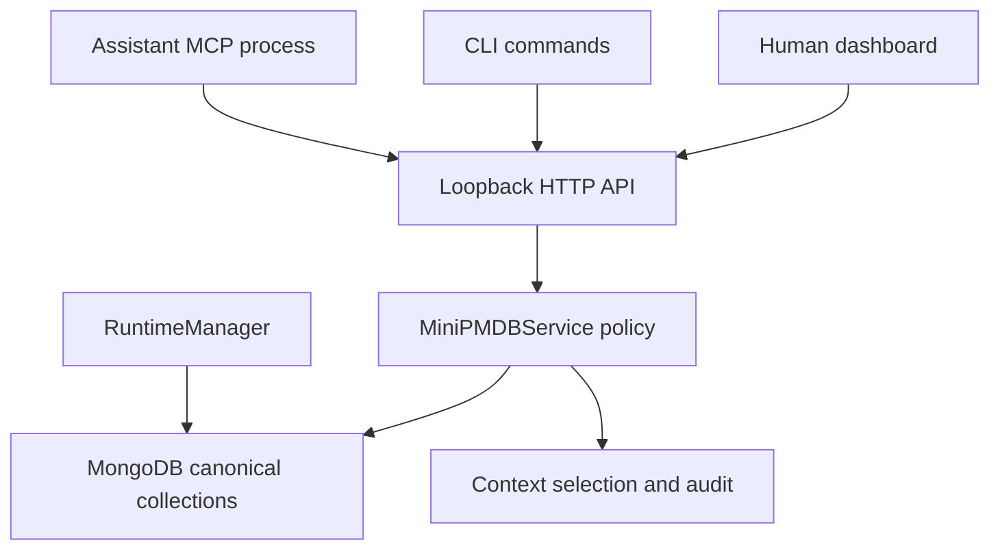
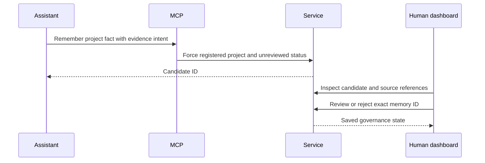
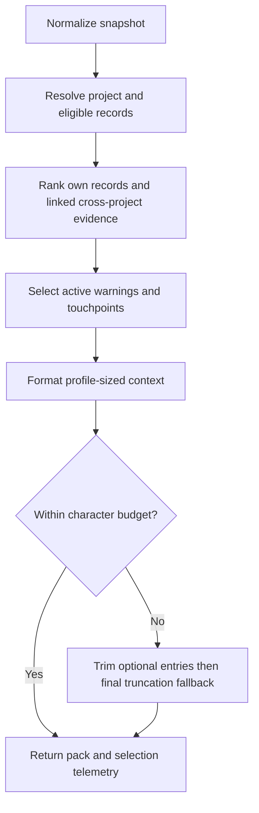

# Architecture and data flow

## Components and ownership

`src/api.js` starts `RuntimeManager`, constructs `MiniPMDBService`, routes requests, and serves the dashboard. `src/runtime.js` owns MongoDB lifecycle. `src/database.js` initializes collections, validators, indexes, snapshots, and connection cleanup. `src/service.js` owns record operations and review policy. `src/schema.js` normalizes data. `src/context.js` selects and formats briefings. `src/audit.js` checks integrity. `src/api-client.js` is shared by the CLI and MCP client surface. `public/app.js` renders dashboard state and submits human actions.

The service is the correct place for a rule shared by several interfaces. A browser-only restriction can be bypassed by the CLI. An MCP-only restriction does not protect the dashboard/API. The database layer should handle persistence mechanics, while service methods express operations such as “attach evidence to an unreviewed candidate.”

## The five collections

| Collection | Identity and important fields | Meaning |
|---|---|---|
| projects | `id`, unique `key`, `name`, `repo_path`, canonical `repo_root`, status, tags, timestamps | Registered project and repository identity |
| memories | `id`, `project_key`, kind, status, confidence, title, body, tags, `source_ids`, critical flag, metadata | A claim and its governance state |
| sources | `id`, `project_key`, type, label, `ref`, creation time | Evidence reference owned by a project |
| links | `id`, relationship, `from`, `to`, reason, status, `resolution_memory_id`, timestamps | Supersession, conflict, or support relationship |
| touchpoints | `id`, name, project keys, kind, status, summary, memory IDs, tags, verification date | Cross-project agreement and its evidence |

Memory titles are bounded to 240 characters and bodies to 8,000 in normalization. Touchpoint summaries are bounded to 2,000. Metadata is an object, not an unrestricted substitute for a new schema. Snapshot normalization requires version 2, all five arrays, and unique IDs within each collection. A structurally valid snapshot may still fail governance audit because a referenced project or source is absent.

MongoDB initializes unique IDs and project keys, a unique nonempty repository-root index, and query indexes for project/status/date and relationship endpoints. Empty repository roots do not collide with one another. The initializer removes an older unique `repo_root_1` index before adding the current partial index. This is startup schema/index management, not a complete versioned migration framework.

## Repository identity

Registration resolves the provided path and attempts `realpath`; on Windows the resolved root is lowercased. MCP resolves its current working directory against an exact registered `repo_root`. Starting MCP from an arbitrary nested directory is therefore not equivalent to registering a repository's root. A moved checkout or a different worktree path may need an intentional registration update. Do not register a near-looking project key merely to make a failed lookup disappear.

`registerProject` upserts by project key and preserves the original creation timestamp. `remember` requires a registered project. It generates a memory ID when none is supplied, stamps creation/update times, and forces candidate status when `reviewFirst` is true. `attachSource` inserts a source then adds its ID to the memory. The project-scoped MCP path additionally checks ownership and candidate status.

## Candidate to reviewed guidance

Human review records reviewer and review note in metadata. Allowed review targets are reviewed, current, rejected, or archived. A caller-supplied reviewer string is a label rather than cryptographic proof of who clicked. Superseding checks that both records exist, updates the old record's status/metadata, and writes a link from replacement to old record. These are multiple writes; the inspected implementation does not wrap them in a transaction.

## Context selection in detail

`buildContextPack` first normalizes the snapshot and requires the requested project. It excludes archived/rejected memories. Own-project memories are ranked by status, task-word matches, critical flag, and conflict warnings. Task words use a simple lowercase token matcher, not semantic embeddings. Ties use newest `updated_at`, then lexicographic ID, making repeated inputs deterministic.

Cross-project memories are reached through a touchpoint's explicit `memory_ids`. They are not retrieved by unrestricted search across every other project. Broken touchpoints and critical warnings receive required-first selection. Own active records are capped at 12 before text trimming. Profile defaults are: `drift_guard` 12,000 characters, `balanced` 7,000, and `compact` 3,500; their body excerpts, warning limits, and touchpoint/cross-project limits also differ.

The formatter writes active truth, cross-project context, warnings/history, and touchpoints. It trims optional entries when over budget. If required content still exceeds the budget, it finally slices the string and adds `[TRUNCATED]`. This last fallback is a real limitation: selected-ID telemetry can still report a critical warning as selected even if the text was cut before its full content. A small pack is not proof that every governing fact was delivered. Use the underlying records and audit output before consequential work.

## Audit behavior

`auditSnapshot` checks the raw references before it builds context for all three profiles. Errors include missing projects, broken source/link references, cross-project source ownership, active records marked unreviewed, high-confidence active claims without sources, unresolved conflicts, invalid resolution records, and incomplete active/broken touchpoints. Candidate review and stale/broken status can produce warnings. Strict mode fails on either errors or warnings; ordinary mode fails only on errors. An awaiting-review warning can be expected work, but it must not be misreported as a strict pass.
