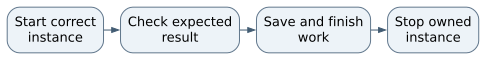

# MiniPMDB Operations Guide

MiniPMDB is a separate memory-trust product with its own MongoDB and dashboard, normally port 8797. It is not the primary PMDB service at 8787. Keep demo projects and real private memory separate.

**Operating status.** Source-defined managed and external modes with NixOS qualification required.

## Start the application

The README demo path is:

```bash
npm ci --ignore-scripts
npm run judge:demo
```

It prints the dashboard address and may open a browser itself. Its managed Mongo mode downloads a pinned upstream binary on first use. Generic managed binaries are not proof of NixOS compatibility. The alternative is the repository's Podman Mongo service:

```bash
podman compose up -d
MINIPMDB_MONGODB_URI=mongodb://127.0.0.1:27017 npm start
```

The environment assignment selects external Mongo before startup. Confirm port 27017 is available before launching this dedicated container; otherwise configure another explicit mapping and matching URI. Credentials belong in the private environment, not a saved credentialed URI.


## Check that it works

Open `http://127.0.0.1:8797` and inspect the storage runtime status. Use the synthetic fail/fix demo only in its demo instance. Real project memory uses project registration and review; a new draft must not be mistaken for approved truth. Local checks include `npm run check`, `npm test`, `npm run smoke`, and `npm run judge:dry-run`; the last can exercise real Mongo startup.

## If something goes wrong

If managed Mongo fails to execute on NixOS, preserve the loader error and use the explicitly configured external Podman route after checking ownership and ports. If the storage runtime changes, restart MiniPMDB as the source instructs. Do not point a synthetic demo at primary PMDB or run demo-reset commands on real data.

## Close the session

Save reviewed work and make an appropriate private database backup when needed. Ctrl+C the foreground MiniPMDB process and verify its own managed child exits when using managed mode. For an external dedicated container, stop it separately only when unused, retaining its named volume. Never delete the database directory to stop the service.

## Known limitation and next repair

The source reports managed-runtime tests on other platforms; that does not establish native NixOS compatibility. Qualify the external Podman route, storage persistence, and graceful restart before calling this installation supported.

## Before you begin

Use this repository root or the precise client/server folder named above. If an installed supervisor already owns this instance, use it instead of starting a second copy. A process is one running program; a port is its numbered network doorway. The address 127.0.0.1 means this machine only.

## Keep troubleshooting scoped

Record the first error, source revision, working directory, and selected instance. Check the stated prerequisites before changing anything. Preserve useful work before resets. Stop only the process or dedicated dependency you own; do not kill by a guessed port or broad name. Keep credentials and private records out of reports. Migrations, seeds, volume deletion, deployment, and new model downloads are separate operations, not generic restart fixes.

## Normal operating sequence



## Maintaining this guide

Keep this Markdown, the editable Word edition, PDF, and operating-flow.svg together here. Update them when merged commands, storage, dependencies, or limits change. Edit Word and export PDF independently when convenient, then inspect the affected pages. No running AIOS service is needed to read or maintain these documents.

Source-defined instructions and known gaps are distinguished above. This documentation task did not launch the application or prove a new production workflow. Verify changes locally on NixOS; use a topic PR and human merge for owned source. Deployment is separate, and routine hosted CI remains disabled.

## Source and edition

Edition 26 October 2026. Repository OchsSoft/MiniPMDB. Inspected source revision `e47f5c1d5b5b0cc82c7e944dcd2ec254244e48de`.

Source files: [README.md](https://github.com/OchsSoft/MiniPMDB/blob/e47f5c1d5b5b0cc82c7e944dcd2ec254244e48de/README.md), [package.json](https://github.com/OchsSoft/MiniPMDB/blob/e47f5c1d5b5b0cc82c7e944dcd2ec254244e48de/package.json).

[Editable Word edition](Operations_Guide.docx) | [PDF edition](Operations_Guide.pdf)
